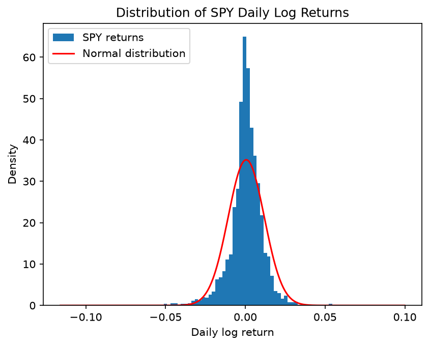
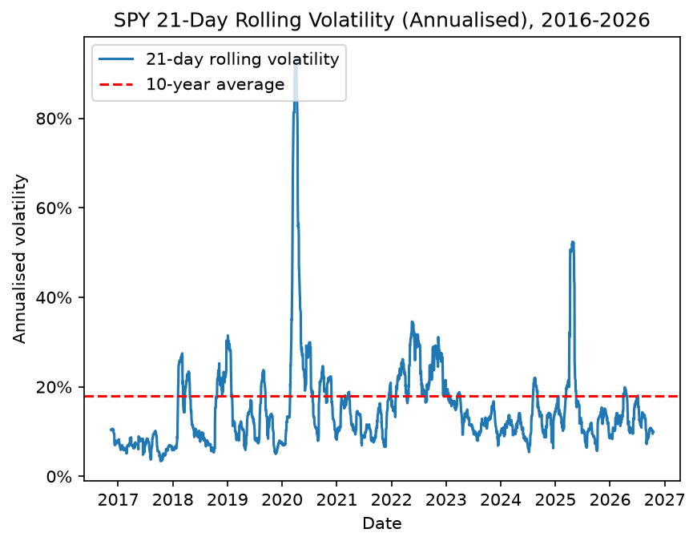

# Option Pricer

An option pricing engine I'm building from scratch in Python while learning to code, alongside my Financial Mathematics degree. The goal is a small pricing and risk library: Black-Scholes, Monte Carlo, binomial trees and Greeks, tested against real market data, with a C++ core later on.

## What's in it so far

| File | What it does |
| --- | --- |
| `payoffs.py` | Call and put payoffs at expiry, plus a straddle profit chart (break-evens and maximum loss) |
| `black_scholes.py` | Black-Scholes call and put prices, using my own normal CDF built by numerically integrating the normal density (`scipy.integrate.quad`); a put-call parity check; a chart of prices against payoffs |
| `monte_carlo.py` | Monte Carlo pricer for a European call: a loop version and a vectorised NumPy version, with standard errors and 95% confidence intervals |
| `monte_carlo_dice.py` | Warm-up: estimating the average dice roll by simulation |
| `market_data.py` | Downloads 10 years of daily SPY prices with yfinance and tests the Black-Scholes assumptions on real data: log returns, annualised and rolling volatility, return distribution vs a normal curve, extreme-day count and kurtosis |
| `data/spy.csv` | Saved SPY price data (2016–2026), so results are reproducible without re-downloading |
| `images/` | Charts generated by `market_data.py`, used in this README |

## Results

Test option: S = 100, K = 100, T = 1 year, r = 5%, σ = 20%.

**Black-Scholes**

| | Price |
| --- | --- |
| Call | 10.4506 |
| Put | 5.5735 |

Put-call parity (C − P = S − Ke^(−rT)) holds to about 1e-14, i.e. rounding error.

**Monte Carlo vs Black-Scholes (call)**

| Paths (N) | MC price | Standard error | 95% confidence interval |
| --- | --- | --- | --- |
| 1,000 | 10.7846 | 0.4605 | 9.8820 to 11.6872 |
| 100,000 | 10.4876 | 0.0467 | 10.3961 to 10.5790 |
| 1,000,000 | 10.4508 | 0.0147 | 10.4220 to 10.4796 |

Every interval contains the Black-Scholes price, and the interval narrows by about 10× for every 100× more paths, as the 1/√N convergence rate predicts.

**Speed: loop vs vectorised (1,000,000 paths, MacBook)**

| Version | Time |
| --- | --- |
| Python loop | ~0.63 s |
| NumPy vectorised | ~0.013 s |

Vectorising with NumPy made the simulation about 48× faster for the same maths.

## Market data analysis: SPY (2016–2026)

`market_data.py` downloads 10 years of daily SPY prices (an ETF tracking the S&P 500)
and tests the assumptions behind Black-Scholes on real data.

| Statistic | Value |
| --- | --- |
| Annualised volatility | 18.0% |
| Average annual log return | 14.5% |
| Days with moves beyond 4σ: expected if normal / actual | 0.16 / 20 |
| Excess kurtosis (normal = 0) | 15.3 (8.2 excluding 2020) |
| 21-day rolling volatility: highest / lowest / latest | 93.7% (Apr 2020) / 3.4% (Oct 2017) / 10.0% |



The chart shows that on most days, SPY’s returns are calmer than the normal distribution predicts: the histogram’s peak is much taller than the bell curve. However, it occasionally makes huge moves that the bell curve says should almost never happen. Over 10 years there were 20 days with moves beyond 4σ, compared with just 0.16 expected under a normal distribution. This is known as “fat tails”.



This chart shows that volatility is far from constant, ranging from 3.4% (October 2017) to 93.7% (April 2020, Covid), a factor of more than 25. It also moves in clusters: calm periods tend to stay calm for months, while crises stay volatile for weeks. This is known as “volatility clustering”. As of 15 October 2026, it is around 10%, well below the 10-year average of 18%.


**Conclusion**: Black-Scholes assumes that returns are normally distributed and that volatility is constant, and the SPY data contradicts both. Because of fat tails, the model underestimates the chance of large crashes or rallies, so options that pay off in extreme scenarios (such as puts far below today’s price, which act as crash protection) are underpriced. And because volatility changes so much over time, there is no single “correct” σ: the 10-year average (18%) and today’s level (10%) give very different option prices. The next step is to price a real SPY option with both and compare the results with market prices.

Then:

## Things I found along the way

- **A deep in-the-money European put can be worth less than its payoff.** At S = 50 the Black-Scholes put is worth about 45.12, while exercising would pay 50. The gap is roughly K(1 − e^(−rT)) ≈ 4.88, because a European put only pays the strike at expiry. Setting r = 0 makes the gap disappear. This is why the right to exercise early gives American puts extra value, while an American call on a non-dividend-paying stock is worth the same as a European one.
- **Testing needs two kinds of check.** Put-call parity passed even when I accidentally swapped r and T, so I also check against known textbook prices.

## How to run it

```bash
python3 -m venv .venv
source .venv/bin/activate
pip install -r requirements.txt
python black_scholes.py
python monte_carlo.py
python market_data.py
```

`market_data.py` uses the saved data in `data/spy.csv`. To download fresh prices instead, uncomment the download lines at the top of the file.

## Next steps

- Verify the confidence intervals empirically (do about 95% of them contain the true price?)
- Convergence chart: Monte Carlo price against N, with the Black-Scholes price and confidence band
- Binomial tree to price American options
- Greeks (delta, gamma, vega) by formula and by finite differences
- Rewrite the pricing core in C++ and call it from Python
- Price a real SPY option using historical vs current volatility
